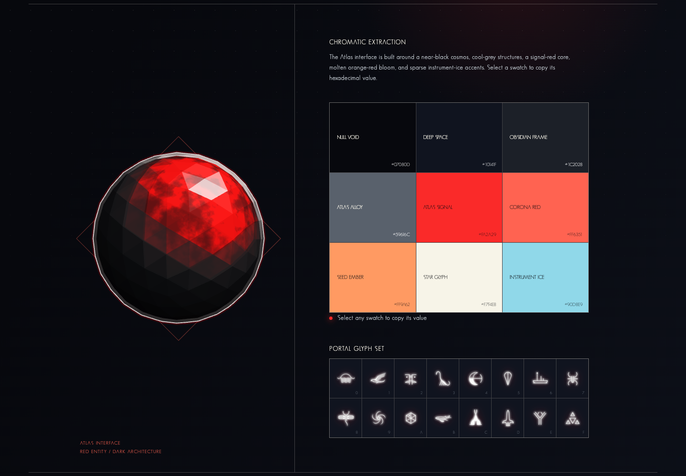

# Atlas Design

A visual study and standalone web components inspired by the Atlas aesthetic from *No Man's Sky*.

## Live site

[Open Atlas Design](https://jikoschnee.github.io/Atlas-Design/)

[Open the chromatic study directly](https://jikoschnee.github.io/Atlas-Design/color-study.html)

## Reference preview

Screenshot of the chromatic study, including the Atlas sphere, color palette, and portal glyphs.



## Contents

- `index.html` — redirects to the chromatic study.
- `color-study.html` — the complete visual study.
- `components/atlas-core` — WebGL Atlas sphere.
- `components/atlas-loader-core` — radial loading core.
- `components/atlas-loader` — composed loading visualization.
- `DESIGN.md` — design language and implementation notes.

## Local preview

```sh
python3 -m http.server 8000
```

Open `http://localhost:8000/`. Individual component demos are available from each component's `index.html`. The demos use the local `vendor/three.min.js`; no installation or build step is required.

## Audio reactive mode

Choose a local music file in the first screen's audio controls, then select **Play**. Use **Pause** to resume later, or adjust **Volume**, including zero to mute. Selecting another file stops the current track and prepares the new one without autoplay.

Both Atlas spheres share one local Web Audio player and analyser. Bass drives subtle breathing; overall energy lifts the red light. The inner core follows quickly (40 ms attack / 180 ms release), while the shell and its contours respond more softly (160 ms attack / 450 ms release). Rotation remains shared. Pausing, muting, or reaching the end smoothly restores the idle appearance.

Audio is decoded on this device and is never uploaded. Format support depends on the browser; MP3, WAV, or M4A are good starting points. Safari requires selecting Play to enable audio. Reduced-motion settings keep the static fallback, even while music plays.

`AtlasCore.mount({ hero, canvas, readAudio })` accepts an optional shared signal reader, called with the animation timestamp. It returns normalized `innerBass`, `outerBass`, `innerEnergy`, and `outerEnergy` values (0–1). Omit the reader for the original idle animation. The returned `destroy()` handle releases rendering resources; `AtlasAudio.mount(root)` returns `read`, `pause`, and `destroy` for the shared player.

## Deployment

GitHub Actions publishes the repository to GitHub Pages after each push to `main`. The workflow can also be run manually.

## Design references

Atlas Path imagery from the official [No Man's Sky OMEGA Update](https://www.nomanssky.com/omega-update/) and historical Atlas Interface captures informed the palette and luminous boundaries. No Man's Sky imagery and related marks belong to their respective owners.
